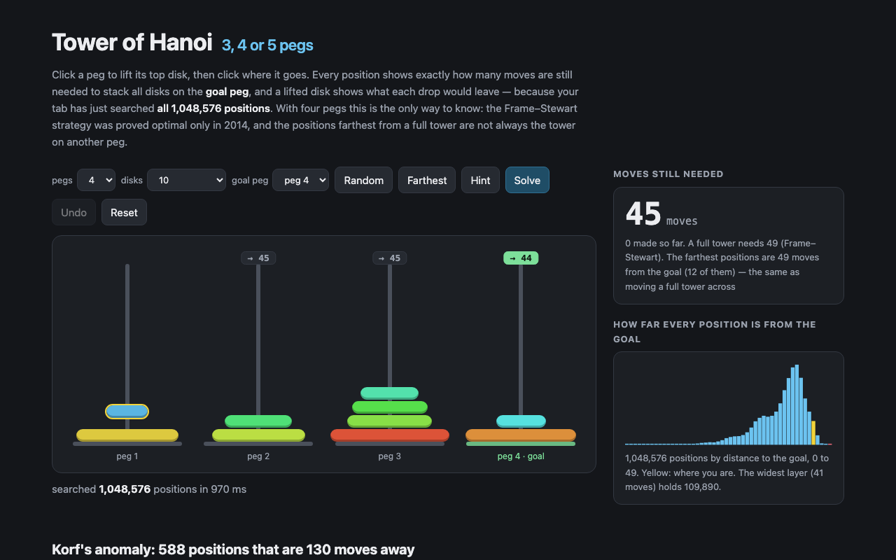

# Tower of Hanoi — 3, 4 or 5 pegs, every position's exact distance



The Tower of Hanoi in the browser, with three, four or five pegs. When you pick a size, your tab runs a
breadth-first search over **every** position (up to 16,777,216 for 4 pegs and 12 disks) and from then on shows
exactly how many moves are still needed from wherever you are. Lift a disk and each peg shows the distance its drop
would leave; **Hint** and **Solve** follow the table downhill; **Farthest** jumps to a position as far from the goal
as the puzzle allows.

With three pegs that is a formula. With four it is not: the Frame–Stewart strategy (1941) was only proved optimal
by Bousch in 2014, and the positions farthest from a full tower are **not always** the tower on another peg.
Richard Korf's complete searches (AAAI 2004) found that with **15 disks** the tower moves across in **129** moves,
yet **588 positions are 130 moves** from it — "We have no explanation for this surprising anomaly".

This repository recomputes that, and every other published number it could find about the puzzle:

- **Korf 2004, Table 2** (radius, state count and widest layer of a complete search from one peg), rows 1–17,
  with `tools/radius.c`: a two-bit breadth-first search, multithreaded, 4<sup>17</sup> ≈ 17.2 billion states in
  4 GiB. All 17 rows match; the 588 at depth 130 match both Korf (2004) and Korf & Felner (2007).
- **Korf 2004, Table 3** (states up to half the solution depth, one per relabelling of the free pegs), rows 1–17.
  Rows 2–17 match; row 1 does not follow the paper's own "rounded up" rule (2 by the rule, 1 printed).
- **OEIS** A007664 (Frame–Stewart), A382111 (the radius sequence, which parts from A007664 at n = 15), A000225,
  A001511, A024023, A125295.
- **Wikipedia** (en and ja): the 466/885 average-distance formula, checked **exactly** (in ℚ(√17)) against the sum of
  all pairwise distances; the optimal Frame–Stewart split; linear Hanoi; the binary and Gray-code solutions, the C bit
  formulas evaluated as written; the graph claims about shortest and longest non-self-crossing paths.

The one Wikipedia value that does not reproduce: the Japanese article's bit formula for the *m*-th move, stated
for moving the tower to the right-hand peg, ends on the **middle** peg whenever the number of disks is even (the
English article notes the swap; the Japanese one does not).

`tools/anomaly.c` then looks at the 588. Every one has the largest disk off the start peg, and for every position with
the largest disk on a free peg some shortest route home moves it exactly once — so each distance splits at the moment
it moves, when the other 14 disks sit on the two remaining pegs (a "gateway"). The page's notes show how the 130
splits.

## Run

```sh
npm install
npm run dev        # http://localhost:5173/portfolio/tower-of-hanoi/
npm test           # vitest
npm run build      # static files in dist/
```

URL parameters: `?pegs=4&disks=10&goal=3&state=0321221032&lift=0` (`state` lists the peg of each disk, smallest
first).

## Recompute the tables

```sh
npm run literature   # tools/literature.json: Wikipedia (en, ja), OEIS, Korf 2004 and Korf & Felner 2007 (needs pdftotext)
npm run stats        # src/stats.json: every published value next to the computed one
```

The large searches are C (any C compiler with pthreads). Their logs are committed in `tools/runs/`, and
`npm run stats` re-runs the same search in TypeScript for every size up to 10 disks and stops if a single layer
count differs from the C log.

```sh
cc -O3 -o /tmp/radius tools/radius.c -lpthread
for n in $(seq 1 17); do /tmp/radius $n 16 tools/runs/far-$n.txt > tools/runs/bfs-$n.log; done   # 17 disks: 4 GiB, minutes
cc -O3 -o /tmp/anomaly tools/anomaly.c -lpthread
/tmp/anomaly 15 tools/runs/far-15.txt 16 > tools/runs/anomaly-15.log                               # 1.8 GiB
```

## Layout

| file | what |
|---|---|
| `src/hanoi.ts` | states, moves, breadth-first search, Frame–Stewart, the 3-peg closed form |
| `src/checks.ts` | every Wikipedia / OEIS claim, recomputed |
| `src/worker.ts` | the search in a Web Worker |
| `src/main.ts` | the page |
| `tools/radius.c` | two-bit BFS of the 4-peg puzzle from one peg, up to 17 disks |
| `tools/anomaly.c` | splits the farthest 15-disk positions at the move of the largest disk |
| `tools/paths.c` | walks every non-self-crossing path between two perfect states (3 pegs) |
| `tools/fetch-literature.mts` | pulls the published values into `tools/literature.json` |
| `tools/stats.mts` | compares them with the computed ones into `src/stats.json` |

## License

MIT
